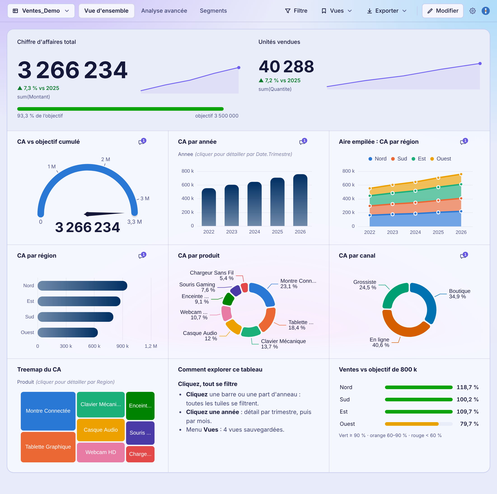
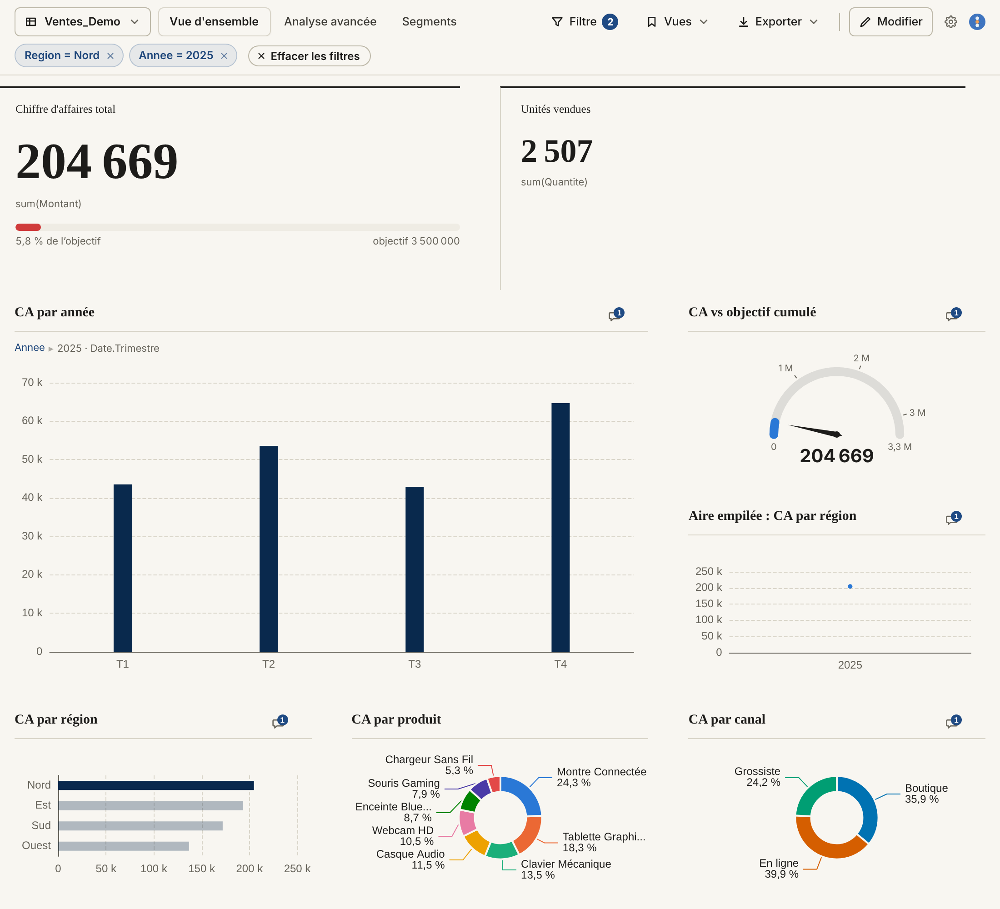
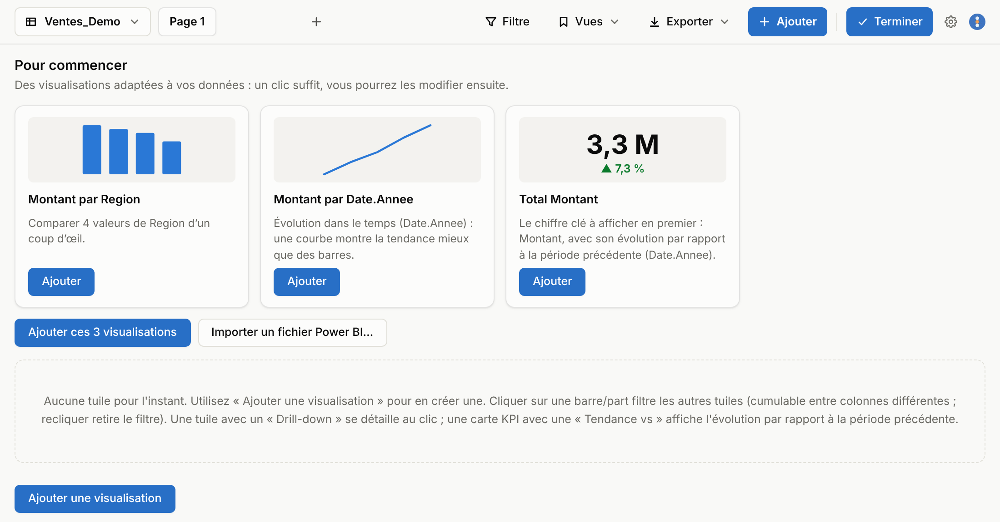
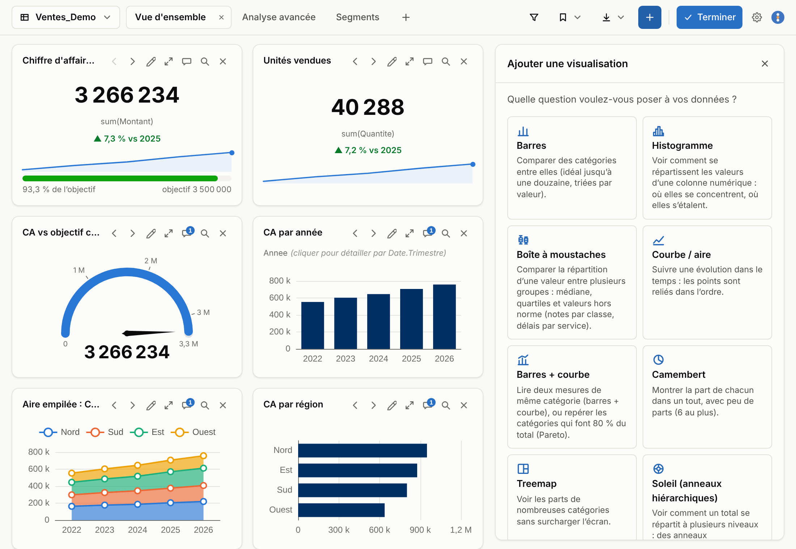
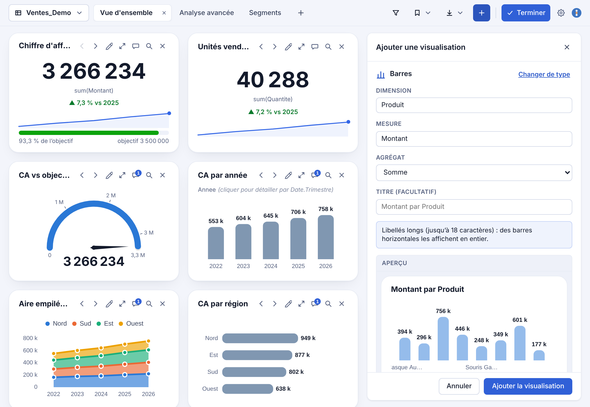
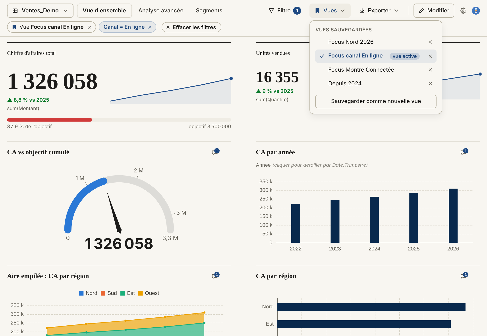
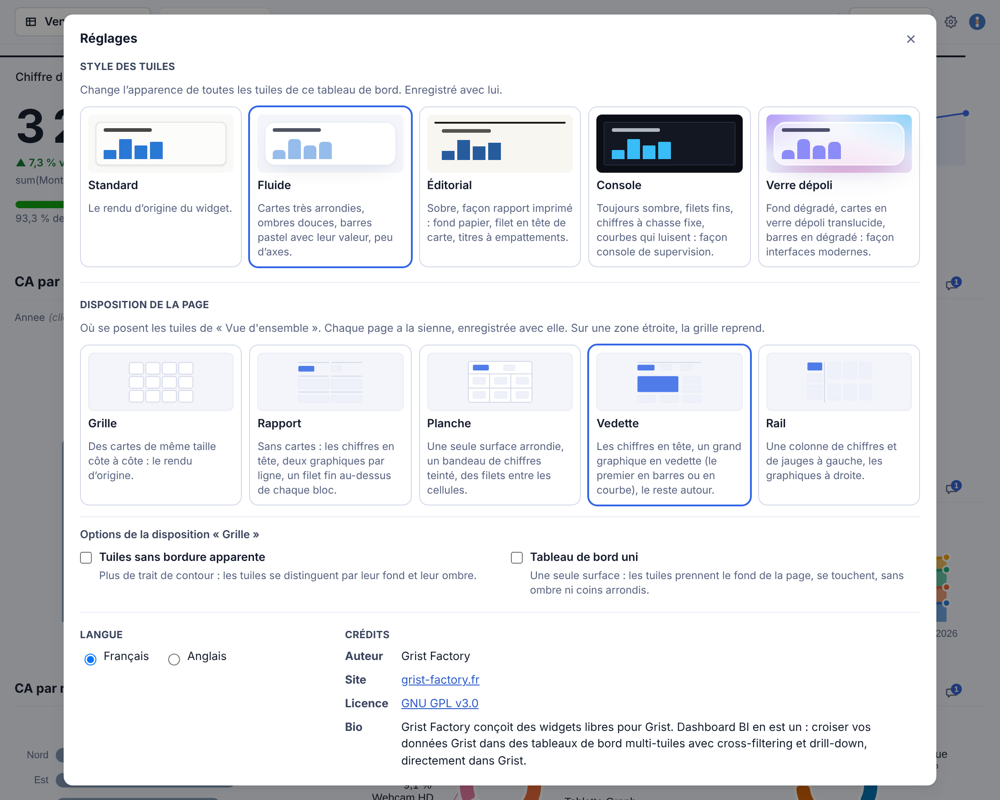
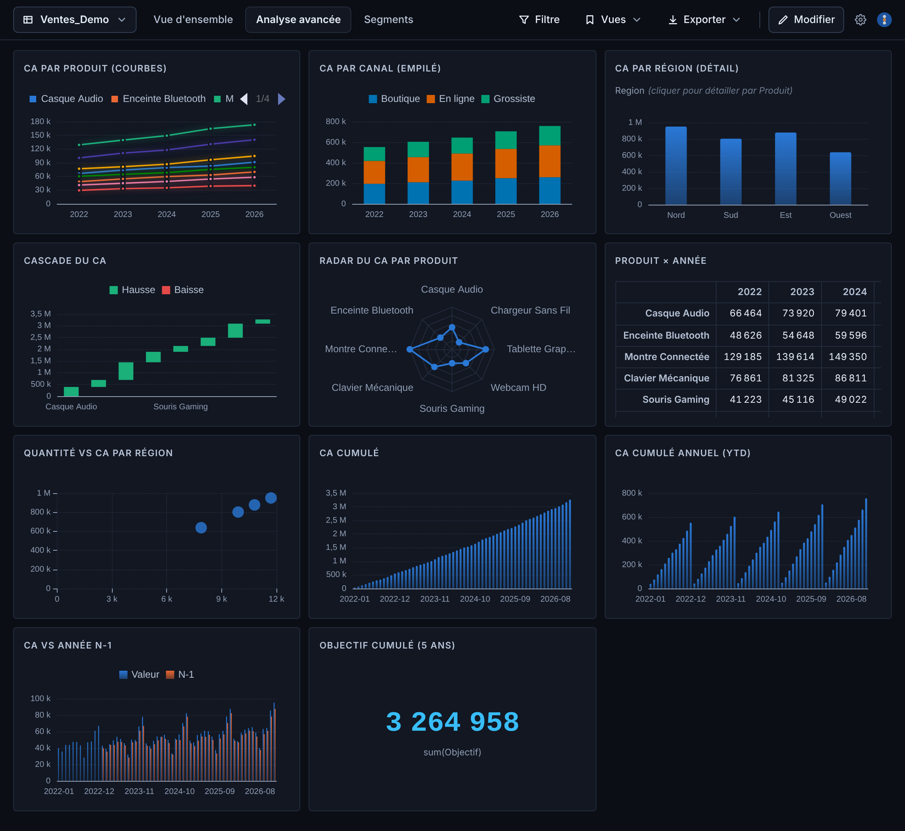
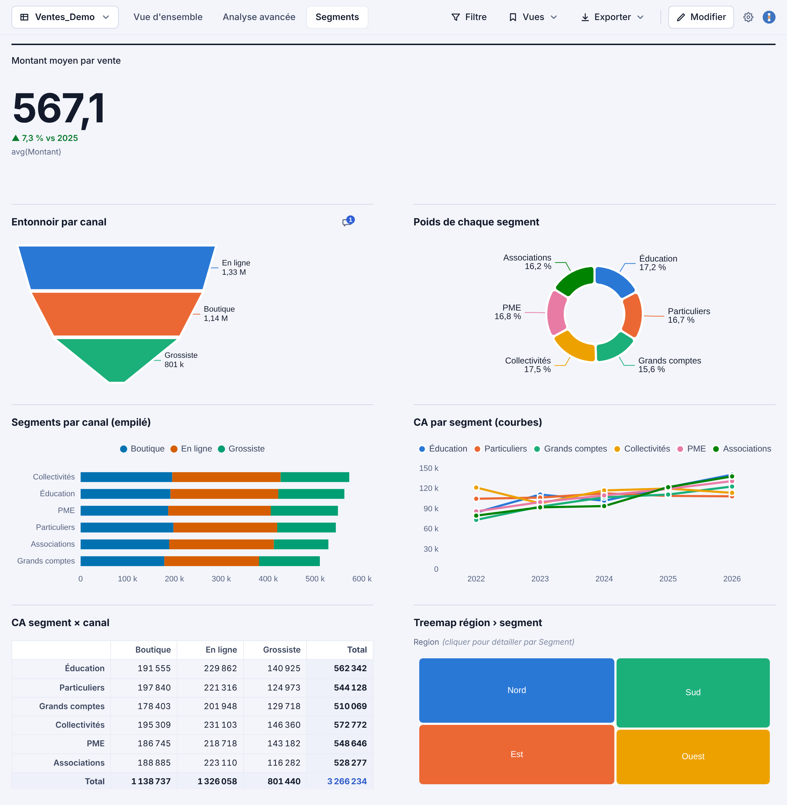
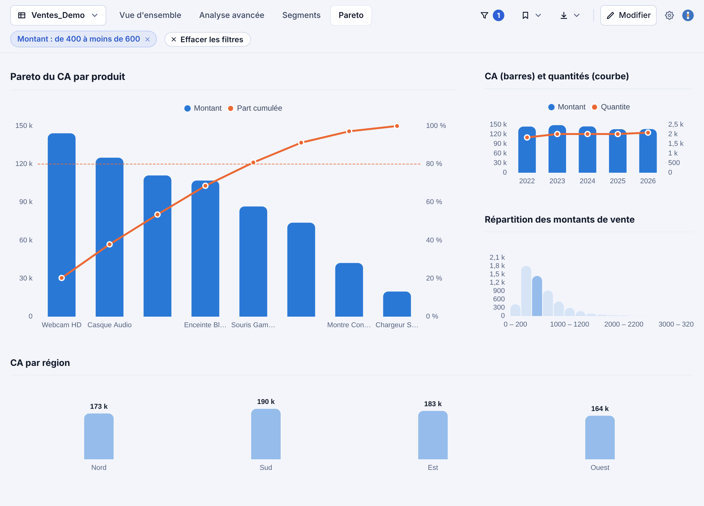

<h1 align="center">Grist BI Dashboard</h1>

<p align="center">
  <strong>Des tableaux de bord interactifs dans Grist, dans un seul widget.</strong><br>
  Plusieurs graphiques et chiffres clés sur la même table, qui se filtrent entre eux d'un clic.
</p>

<p align="center">
  
  
  
</p>

<p align="center">
  <a href="#essayer-le-widget">Essayer</a> ·
  <a href="#tutoriel-pas-à-pas">Tutoriel</a> ·
  <a href="#les-22-types-de-tuiles">Types de tuiles</a> ·
  <a href="#limites-connues-de-lalpha">Limites</a> ·
  <a href="#sécurité-et-confidentialité">Sécurité</a> ·
  <a href="#english-summary">English</a>
</p>

<p align="center">
  
  <br>
  <sub>Style « Verre dépoli », disposition « Planche ». Les captures de ce document montrent des données de démonstration fictives.</sub>
</p>

## En bref

**Grist BI Dashboard** est un widget personnalisé pour [Grist](https://www.getgrist.com/). Il transforme une table de votre document en tableau de bord : des graphiques et des cartes de chiffres clés côte à côte, qui réagissent les uns aux autres, avec détail progressif (drill-down), vues sauvegardées et exports PDF et PowerPoint.

Il reprend des mécaniques de **Power BI** et de **DigDash** que Grist n'a pas nativement. Comme un widget Grist ne peut pas en piloter un autre sur la même page, tout vit dans un seul widget, avec ses propres tuiles.

- **Aucun serveur, aucun compte, aucune installation.** Une page web statique : vos données restent dans votre document Grist.
- **Pas besoin de savoir coder.** On choisit un type de graphique, deux colonnes, et l'aperçu se met à jour en direct.
- **Libre** (licence GPL v3), en français et en anglais.

> [!NOTE]
> **Version alpha.** Le widget est utilisable, mais il a surtout été essayé sur des données de démonstration. Un essai dans un vrai document Grist (47 000 lignes, filtrage croisé, drill-down) s'est bien passé ; les fonctions plus récentes n'ont pas encore été éprouvées dans beaucoup de vrais documents. Testez-le sur une copie de vos données et dites-nous ce qui casse : voir [Limites connues](#limites-connues-de-lalpha) et [Donner un retour](#donner-un-retour).

## Ce qu'il sait faire

- **Filtrage croisé au clic**, comme un slicer Power BI : cliquer une barre ou une part filtre toutes les autres tuiles. Les filtres se cumulent et se retirent d'un clic.
- **Drill-down** par tuile, avec fil d'Ariane cliquable : sur une colonne date, année, trimestre et mois sont proposés automatiquement.
- **22 types de tuiles** : barres, courbes, anneaux, treemap, soleil, flux (Sankey), calendrier, Gantt, histogramme, boîte à moustaches, radar, carte de chaleur, tableau croisé… ([liste complète](#les-22-types-de-tuiles)).
- **Cartes de chiffres clés** avec tendance (par rapport à la période précédente), courbe, objectif et seuils de couleur.
- **Mesures temporelles** : cumul, cumul annuel (YTD) et comparaison à l'année précédente.
- **Cinq styles d'affichage** (Standard, Fluide, Éditorial, Console, Verre dépoli) et **cinq dispositions de page** (Grille, Rapport, Planche, Vedette, Rail), réglables page par page.
- **Filtres avancés** : plage de valeurs, plage de dates, dates relatives (30 derniers jours, ce mois-ci…), recherche dans le texte.
- **Plusieurs pages** par tableau de bord et **vues sauvegardées** : on mémorise un état de filtres et de drill-down, on le retrouve en un clic.
- **Assistant de démarrage** : sur un tableau de bord vide, des visualisations sont suggérées d'après vos colonnes.
- **Jointure** avec une deuxième table du même document.
- **Commentaires par tuile**, stockés dans une table du document.
- **Mots-clés des publications** (menu de la table, en mode édition) : remplit une colonne de mots-clés à partir d'une colonne de texte (titre, résumé…), après confirmation.
- **Exports PDF et PowerPoint**, fidèles à l'écran (l'export Excel, déjà écrit, est grisé dans l'alpha : « bientôt disponible »).
- **Gros volumes** : au-delà de 5 000 lignes, un moteur SQL (DuckDB-WASM) prend le relais dans le navigateur.
- **Import d'un fichier Power BI** (`.pbix` ou `.pbit`) : reprend les visuels (type, colonnes, titre) comme tuiles de départ. Les données et les mesures DAX ne sont pas reprises ; un CSV exporté de Power BI peut être importé pour les données.

<p align="center">
  
  <br>
  <sub>Un clic sur « Nord » puis sur « 2025 » : toutes les tuiles se recalculent, la tuile des années descend en trimestres, et les filtres actifs s'affichent en pastilles. Style « Éditorial », disposition « Vedette ».</sub>
</p>

## Essayer le widget

L'adresse du widget, à coller dans Grist (voir le tutoriel ci-dessous) :

```text
https://grist-factory.github.io/grist-widget-grist-BI/
```

Il faut un document Grist que vous pouvez modifier, et le niveau d'accès « accès complet » (voir [Sécurité et confidentialité](#sécurité-et-confidentialité) pour savoir pourquoi, et ce que le widget en fait). Le widget ne crée ni ne modifie vos tables de données.

## Tutoriel pas à pas

### 1. Ajouter le widget dans votre document

1. Dans votre document Grist, ouvrez une page et ajoutez un widget : **Ajouter** → **Ajouter un widget à la page** (*Add widget to page*).
2. Choisissez le widget **Personnalisé** (*Custom*). Grist demande une table à lier : prenez n'importe laquelle, même vide. Le widget n'en tient pas compte, il se connecte lui-même à sa table de travail (étape 2).
3. Dans le panneau de droite, choisissez **URL personnalisée** (*Custom URL*) et collez l'adresse du widget (voir ci-dessus).
4. Réglez le niveau d'accès sur **Accès complet au document** (*Full document access*) et acceptez la demande de Grist.

Astuce : donnez-lui une page entière, un tableau de bord a besoin de place.

### 2. Choisir la table de travail

Au chargement, le widget se connecte tout seul à la **première table** du document. Pour en choisir une autre, cliquez sur le bouton en haut à gauche (il porte le nom de la table), puis sur **Table de travail**. Chaque table garde sa propre configuration : revenir sur une table déjà visitée restaure ses tuiles.

Si le document ne contient encore aucune table, le widget le dit et attend : créez une table dans Grist, puis choisissez-la.

En mode édition, ce même menu permet de **joindre une deuxième table** du document : vous indiquez la colonne clé de chaque table, et les colonnes de la seconde apparaissent (préfixées de son nom) dans tous les sélecteurs.

### 3. Construire le tableau de bord

Cliquez sur **Modifier** (en haut à droite) pour passer en mode édition. Sur un tableau de bord vide, le widget propose des visualisations d'après vos colonnes : un clic sur **Ajouter** suffit, vous pourrez les modifier ensuite.

<p align="center">
  
  <br>
  <sub>Premier lancement : des visualisations suggérées, ou l'import d'un fichier Power BI.</sub>
</p>

Pour composer vous-même, cliquez sur **Ajouter** dans la barre du haut. Le panneau « Ajouter une visualisation » s'ouvre à droite, en deux étapes :

1. **Choisir** : une carte par type de tuile, avec une ligne qui dit à quoi il sert.
2. **Régler** : la dimension (ce qu'on regroupe), la mesure (ce qu'on calcule), l'agrégat (somme, moyenne, comptage, minimum, maximum) et un titre facultatif. L'**aperçu** se met à jour en direct. Les *Options avancées* ouvrent le reste : séries, empilage, palette, format des nombres, ligne de repère, étiquettes de valeur, niveaux de drill-down…

<p align="center">
  
</p>

<p align="center">
  
  <br>
  <sub>On choisit un type, deux colonnes, et l'aperçu se met à jour en direct.</sub>
</p>

En mode édition, chaque tuile porte ses boutons : flèches pour la déplacer, crayon pour la modifier, agrandir, commentaire, détail (les lignes brutes) et croix pour la supprimer. Cliquez sur **Terminer** pour revenir en lecture : c'est le mode des personnes qui consultent le tableau de bord.

### 4. Explorer : filtres croisés, drill-down, filtres avancés

- **Cliquez sur une barre, une part d'anneau, une case…** : les autres tuiles se filtrent. Les valeurs non retenues s'estompent dans la tuile cliquée. Cliquer sur une autre colonne cumule les filtres ; cliquer à nouveau sur la même valeur, ou sur la croix de sa pastille, retire juste ce filtre. **Effacer les filtres** les retire tous. Sur un histogramme, un clic sur une classe filtre par plage de valeurs.
- **Détailler** : sur une tuile avec drill-down, la mention « cliquer pour détailler par… » sous le titre annonce le niveau suivant. Un clic descend d'un niveau (par exemple année → trimestre → mois), le fil d'Ariane permet de remonter. Au niveau le plus profond, un clic redevient un filtre croisé.
- **Filtrer sans cliquer sur une tuile** : le bouton **Filtre** de la barre liste vos colonnes ; selon la colonne, on règle une plage de valeurs, une plage de dates, une période relative ou une recherche dans le texte.
- **Agrandir** une tuile pour la lire en grand, ou ouvrir son **détail** pour voir les lignes brutes qui la composent.
- **Commenter** : chaque tuile peut porter des commentaires, visibles de toutes les personnes qui ouvrent le document.

### 5. Mémoriser : vues sauvegardées et pages

<p align="center">
  
  <br>
  <sub>Le menu Vues : un état de filtres se retrouve en un clic ; la vue active est suivie, et signalée quand vos filtres s'en écartent.</sub>
</p>

- **Vues** : une vue mémorise l'état des filtres croisés, des filtres avancés et du drill-down sous un nom. Le menu **Vues** permet de la réappliquer, de la mettre à jour ou de la supprimer.
- **Pages** : en mode édition, le bouton **+** de la barre ajoute une page, un double-clic sur un onglet la renomme. Chaque page a ses propres tuiles ; les filtres, eux, restent communs à toutes les pages.

### 6. Mettre en forme : style et disposition

Le bouton **Réglages** (la roue dentée) ouvre le choix du **style** (comment s'habillent les tuiles : Standard, Fluide, Éditorial, Console, Verre dépoli) et de la **disposition de la page** (où elles se posent : Grille, Rapport, Planche, Vedette, Rail). Le style vaut pour tout le tableau de bord, la disposition se choisit page par page, et les deux sont enregistrés avec le tableau de bord. C'est aussi là qu'on change la langue (français ou anglais).

<p align="center">
  
</p>

<p align="center">
  
  
  <br>
  <sub>À gauche, le style « Console » (toujours sombre) : analyses avancées. À droite, « Fluide » en disposition « Rapport » : segments et canaux.</sub>
</p>

### 7. Exporter

Le menu **Exporter** propose deux formats actifs. Dans les deux cas, le fichier reprend ce que vous voyez : mêmes filtres, mêmes niveaux de drill-down, même style.

| Format | Contenu |
|---|---|
| **PDF** | La page affichée, en une seule page à la largeur d'un A4 paysage, avec un bandeau (nom de la page, jeu de données, date, vue suivie, filtres actifs). |
| **PowerPoint** (`.pptx`) | La page affichée en première diapositive, puis une diapositive par tuile. |
| **Excel** (`.xlsx`) | **Bientôt disponible** : le bouton est grisé dans l'alpha. L'export est écrit (un classeur avec, pour chaque page, une feuille « tableau de bord » en images et des tableaux Excel nommés pour les données) mais n'a pas encore été essayé dans un vrai Excel : il reviendra avec la bêta. |

Ce sont des **images** de vos tuiles, pas des graphiques modifiables : c'est ce qui garantit le même visuel qu'à l'écran. Voir les [limites](#limites-connues-de-lalpha).

<p align="center">
  
  <br>
  <sub>Barres + courbe (Pareto et double axe) et histogramme : un clic sur une classe filtre toutes les autres tuiles.</sub>
</p>

## Les 22 types de tuiles

Tous se choisissent dans « Ajouter une visualisation ». Chacun est proposé avec une ligne d'aide, et l'assistant avertit quand le choix se prête mal à vos données (un anneau de vingt parts, par exemple).

| Pour… | Types de tuiles |
|---|---|
| **Comparer et classer** | Barres (verticales ou horizontales, triées, en séries, empilées ou en 100 %, en petits multiples) · Barres + courbe (double axe, ou diagramme de Pareto) · Cascade · Entonnoir · Progression (une barre par catégorie, en % d'un objectif) |
| **Suivre dans le temps** | Courbe / aire (lissée ou en escalier) · Calendrier (une case par jour) · Gantt (une barre par tâche, couleur par statut, repère « aujourd'hui ») |
| **Montrer des parts d'un tout** | Camembert / anneau · Treemap · Soleil (anneaux hiérarchiques) · Flux / Sankey (d'une catégorie à une autre) |
| **Étudier une répartition** | Histogramme · Boîte à moustaches (médiane, quartiles, valeurs aberrantes) · Nuage de points (ou bulles : taille et couleur en plus) · Radar |
| **Afficher un chiffre** | Carte KPI (tendance, courbe, objectif, seuils de couleur) · Jauge |
| **Lire des valeurs** | Tableau croisé (cellules colorables) · Carte de chaleur · Table plate (colonnes au choix, tri d'un clic) |
| **Expliquer** | Texte : une note sans données (titre, liste, gras) |

Un vingt-troisième type, le **nuage de mots**, apparaît grisé dans la version autonome (voir les [limites](#limites-connues-de-lalpha)).

## Limites connues de l'alpha

Voici ce qu'il vaut mieux savoir avant de l'adopter.

- **Peu éprouvé en conditions réelles.** Les essais en vrai Grist ont porté sur une table de 47 000 lignes (filtrage croisé, drill-down, dates, colonnes Référence, mesures temporelles, commentaires), puis sur un document de démonstration (commentaires, exports PDF et PowerPoint). Le reste (les nouveaux types de tuiles, les styles et dispositions, le format des nombres « comme dans la colonne », l'import Power BI, les mots-clés) n'a été vérifié que sur des données de démonstration, avec un faux Grist. Attendez-vous à des défauts, surtout avec beaucoup de colonnes, des colonnes Référence, des dates et heures, ou de très grosses tables.
- **Accès complet demandé.** Grist n'offre pas de palier intermédiaire à un widget qui enregistre sa propre configuration. Le widget crée trois tables internes, visibles dans les Données brutes (`BI_Dashboard_Config`, `BI_Dashboard_Comments`, `BI_Dashboard_UserProbe`). Pour restreindre ce qu'il peut lire, utilisez les règles d'accès natives de Grist.
- **Les exports sont des images.** Les tuiles exportées en PDF et PowerPoint sont des photos de l'écran : pas de graphiques PowerPoint modifiables, texte non sélectionnable dans le PDF, et une tuile rognée à l'écran (un tableau croisé très large) l'est aussi dans le fichier : agrandissez-la avant d'exporter.
- **L'export Excel n'est pas ouvert.** Le bouton est grisé (« bientôt disponible ») : l'export n'a jamais été ouvert dans un vrai Excel, il revient avec la bêta.
- **L'export PowerPoint demande une connexion** : sa bibliothèque est chargée à la demande depuis un CDN (version figée, empreinte vérifiée). L'export PDF n'appelle aucun service extérieur.
- **Le premier gros calcul est un peu lent.** Au-delà de 5 000 lignes, le moteur SQL (environ 34 Mo) se télécharge la première fois qu'il sert. Si ce moteur ne peut pas se charger, le calcul se fait en JavaScript (plus lent sur de gros volumes), sauf les mesures temporelles, qui exigent le moteur SQL.
- **Nuage de mots et lecture de PDF : pas dans cette version.** Ces deux fonctions demandent des extensions fournies par l'hôte Grist Factory Suite : elles sont grisées dans l'interface quand le widget tourne seul, et un clic l'explique. Les mots-clés calculés à partir d'une colonne de texte, eux, ne dépendent d'aucune extension.
- **Mesures temporelles simplifiées.** Cumul, YTD et comparaison N-1 se règlent sur une tuile en barres, par mois uniquement : ce n'est pas un langage de mesures complet façon DAX.
- **Quelques choix de conception.** Le nuage de points est agrégé (un point par catégorie, pas par ligne) ; le radar ne filtre pas les autres tuiles ; une table plate affiche 500 lignes au plus ; les filtres croisés et le drill-down sont communs à toutes les pages.
- **Textes tirés de vos données non traduits.** Seule l'interface est bilingue : les titres de tuile composés à partir de noms de colonnes et les en-têtes des exports gardent le nom de vos colonnes.
- **Pas encore essayé** : le widget avec un compte en lecture seule (on s'attend à ce que les clics de filtrage fonctionnent dans le navigateur, mais que l'enregistrement des vues, des commentaires et de la configuration soit refusé), la reconnaissance automatique de l'auteur d'un commentaire (sinon, le nom se saisit à la main), et l'usage sur téléphone.
- **Navigateurs.** Le widget a surtout été essayé sous Chromium (Chrome, Edge). Firefox et Safari n'ont pas été vérifiés.

## Sécurité et confidentialité

**Vos données ne quittent pas votre navigateur, hors de Grist.** Le widget n'a pas de serveur et n'envoie aucune donnée ailleurs : les seules adresses qu'il contacte sont celles du tableau ci-dessous. Tout se calcule dans la page, y compris les gros volumes (DuckDB-WASM) et les exports.

### Ce que le widget lit et écrit avec l'accès complet

- Il **lit** la table de travail que vous choisissez (la première du document au démarrage), les métadonnées de ses colonnes (type, format) et, à la demande, les pièces jointes d'une colonne.
- Il **écrit** dans trois tables internes, jamais dans vos données : `BI_Dashboard_Config` (le tableau de bord), `BI_Dashboard_Comments` (les commentaires) et `BI_Dashboard_UserProbe` (une ligne éphémère pour connaître l'adresse de la personne qui commente).
- Il ne modifie vos tables que sur un **geste explicite, après une fenêtre de confirmation** : la création d'une table à l'import d'un CSV exporté de Power BI, et l'ajout d'une colonne de mots-clés puis l'écriture de ses cellules vides.
- Il n'utilise jamais `RemoveTable`, `RemoveColumn` ni `BulkRemoveRecord`.

### Ce que le widget charge, et quand

| Quoi | D'où | Quand |
|---|---|---|
| API de widget de Grist (`grist-plugin-api.js`) | `docs.getgrist.com` | au démarrage |
| La page du widget, ses scripts, ECharts 6.1.0 | le site qui héberge le widget | au démarrage |
| DuckDB-WASM 1.32.0 (et ses dépendances Apache Arrow, FlatBuffers, tslib) | copies dans `js/vendor/`, même site | au premier gros calcul (plus de 5 000 lignes) |
| ExcelJS 4.4.0 | copie dans `js/vendor/`, même site | au premier export Excel : l'export étant grisé dans l'alpha, elle n'est pas chargée pour l'instant |
| Kit des apps Grist Factory (`kit/`) : fenêtres de confirmation, ambiance | même site | au démarrage, puis à la première fenêtre de confirmation |
| PptxGenJS 4.0.1 | `cdn.jsdelivr.net`, version figée, empreinte d'intégrité (SRI, sha384) | au premier export PowerPoint |
| Extensions de l'hôte Grist Factory Suite (`d3-cloud`, `pdf.js`) | l'adresse et l'empreinte que l'hôte donne | seulement si le widget est lancé dans cet hôte et que l'extension est ajoutée : jamais en version autonome |
| Pièces jointes d'une publication | l'API du document, à l'adresse que Grist donne avec un jeton en lecture seule (refusée si elle n'est pas en https) | à chaque PDF d'un lot de mots-clés, avec l'extension seulement |

Chaque dossier de `js/vendor/` contient la licence de la bibliothèque qu'il embarque.

### Comment c'est verrouillé

- **Un seul chargeur de code.** Tout code chargé à l'exécution passe par `js/loader.js` : https obligatoire hors du site lui-même, empreinte d'intégrité exigée pour tout autre site, aucun identifiant dans l'adresse. Les modules ES se demandent par nom, depuis une liste fermée (`js/modules.js`).
- **Un seul chemin pour écrire du HTML.** Tout balisage écrit dans la page passe par `js/safe-html.js` (liste blanche de balises, d'attributs et de styles), jamais par `innerHTML`. Les valeurs de vos cellules et la configuration lue dans le document sont traitées comme des entrées non fiables et échappées.
- **Une politique de sécurité du contenu** (balise `<meta>` en tête d'`index.html`) refuse tout par défaut, puis n'ouvre que le nécessaire : les scripts du site lui-même et d'adresses https, un seul script en ligne vérifié par empreinte, aucun formulaire qui part. `'unsafe-eval'` y est permis, car le script d'API que Grist sert (`grist-plugin-api.js`) s'exécute par `eval` et le widget ne démarrerait pas dans Grist sans cela ; aucun code de ce dépôt n'appelle `eval` ni `new Function`. Les styles en ligne restent permis, car la photographie des tuiles pour les exports et ECharts en posent.

Une faille se signale **sans ouvrir d'issue publique** : onglet « Security » du dépôt GitHub, puis « Report a vulnerability » (signalement privé).

## Héberger votre propre copie

Le widget est une **page statique** : pas de `package.json`, pas d'étape de build, pas de serveur applicatif. Pour l'héberger vous-même, copiez le dépôt sur n'importe quel hébergement statique en https (GitHub Pages, un serveur web, un stockage objet…) et collez son adresse dans Grist à la place de celle ci-dessus.

Deux points d'attention : selon la façon dont Grist cadre le widget, ses modules ES se chargent en mode CORS, donc le serveur doit envoyer l'en-tête `Access-Control-Allow-Origin` (GitHub Pages le fait) ; sans lui, le moteur SQL et les fenêtres de confirmation ne se chargent pas et le widget retombe sur ses solutions de repli (calcul en JavaScript, boîtes de dialogue du navigateur). Et ouvert directement dans un navigateur, hors de Grist, il n'affiche rien d'utile : il a besoin de l'API de Grist pour lire une table.

## Sous le capot

JavaScript sans framework ni étape de build ; la configuration du tableau de bord est stockée dans la table Grist interne `BI_Dashboard_Config`. Graphiques : [Apache ECharts](https://echarts.apache.org/) 6.1.0. Gros volumes : [DuckDB-WASM](https://github.com/duckdb/duckdb-wasm) 1.32.0. Export Excel (grisé dans l'alpha) : [ExcelJS](https://github.com/exceljs/exceljs) 4.4.0. Export PowerPoint : [PptxGenJS](https://gitbrent.github.io/PptxGenJS/) 4.0.1. L'export PDF est écrit sans bibliothèque. Les bibliothèques embarquées sont des copies locales dans `js/vendor/`, jamais chargées depuis un CDN (un réseau d'entreprise qui filtre un CDN laisserait sinon les graphiques vides, sans erreur), à l'exception de PptxGenJS.

## Donner un retour

Les retours sont ce qui manque le plus à cette alpha. Ouvrez une *issue* sur ce dépôt en disant : ce que vous attendiez, ce qui s'est passé, le navigateur utilisé, la taille approximative de la table (lignes et colonnes) et, si vous le pouvez, une capture d'écran. Évitez d'y coller des données sensibles. Cherchés en priorité : de vraies tables avec beaucoup de colonnes, des colonnes Référence, des dates et heures, de gros volumes, et tout ce qui est confus dans l'interface.

## Licence

Le code de ce dépôt est publié sous **GNU GPL v3.0** : voir [LICENSE](./LICENSE). Les bibliothèques embarquées gardent leur propre licence, incluse dans chaque dossier de `js/vendor/` :

| Bibliothèque | Licence |
|---|---|
| Apache ECharts, Apache Arrow, FlatBuffers | Apache-2.0 |
| DuckDB-WASM, ExcelJS | MIT |
| tslib | 0BSD |

## Crédits

Conçu et développé par **[Grist Factory](https://grist-factory.fr)**, qui réalise des widgets libres pour Grist. Merci à l'équipe de [Grist](https://www.getgrist.com/) pour la plateforme et son API de widgets, et aux auteurs des bibliothèques libres citées plus haut.

---

## English summary

**Grist BI Dashboard** is a custom [Grist](https://www.getgrist.com/) widget that turns a table of your document into an interactive dashboard, borrowing mechanics from Power BI and DigDash: several charts and KPI cards on the same table that **filter each other on click** (cross-filtering), **drill-down** with a breadcrumb, saved views, multiple pages, and **PDF and PowerPoint exports**. It is a static web page: no server, no build step, and your data stays in your Grist document.

> [!NOTE]
> **Alpha.** Usable, but mostly tested on demo data (one real-document trial on a 47,000-row table). Try it on a copy of your data, and please report what breaks.

**Try it:** in a Grist page, add a *Custom* widget, choose *Custom URL*, paste the address below and grant *Full document access*.

```text
https://grist-factory.github.io/grist-widget-grist-BI/
```

**Quick start**

1. The widget connects by itself to the **first table** of your document; use the button at the top left to pick another one (it can also join a second table).
2. Click **Edit**. On an empty dashboard it suggests visualizations based on your columns; or click **Add**, pick a tile type, choose columns and watch the live preview.
3. Click a bar or a slice to filter every other tile; click again to clear. Click a year to drill down to quarters and months. Use **Filter** for ranges, dates and text search.
4. Save a **view** to come back to a filtered state in one click; add **pages** for more tiles.
5. In **Settings** (gear icon), pick one of five tile **styles**, one of five page **layouts**, and the interface language (French or English).
6. **Export** to PDF or PowerPoint (the page as drawn on screen). The Excel export is written but greyed out ("coming soon") in the alpha; it returns with the beta.

**What it offers:** 22 tile types (bars, lines and areas, combo with Pareto, pies and donuts, treemap, sunburst, Sankey, calendar, Gantt, histogram, box plot, bubble and scatter, radar, waterfall, funnel, gauge, KPI, progress, pivot table, heatmap, flat table, text note); KPI cards with trend, sparkline and target; cumulative, year-to-date and previous-year measures; advanced filters; comments per tile; import of a Power BI file's layout (`.pbix`/`.pbit`); automatic switch to an in-browser SQL engine (DuckDB-WASM) above 5,000 rows.

**Known limits of the alpha**

- Few real-world trials so far: expect rough edges with wide tables, Reference columns, date-times and very large tables.
- Full document access is required (Grist has no intermediate level for a widget that saves its own configuration). The widget creates three internal tables (`BI_Dashboard_Config`, `BI_Dashboard_Comments`, `BI_Dashboard_UserProbe`) and never creates or edits your data tables without an explicit confirmation.
- PDF and PowerPoint exports are **images** of the tiles, not editable charts; the PowerPoint export needs an internet connection to load its library. The Excel export is not open in the alpha.
- The first heavy calculation downloads the SQL engine (about 34 MB).
- The word cloud and PDF reading need extensions that are not part of this standalone version; they appear greyed out.
- Mostly tried in Chromium-based browsers; read-only accounts and phones have not been tried.
- Only the interface is bilingual; titles and export headers built from your column names are not translated.

**License:** GNU GPL v3.0, see [LICENSE](./LICENSE). Bundled libraries keep their own licenses (Apache-2.0, MIT, 0BSD), included in each `js/vendor/` folder. Made by [Grist Factory](https://grist-factory.fr).
